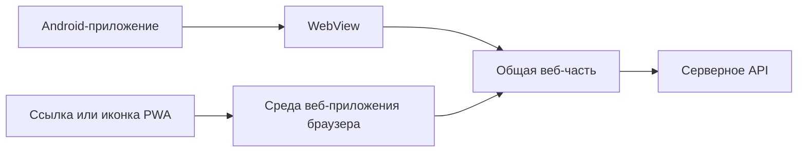

# PWA и WebView для нашей команды

Наша команда уже опубликовала Android-приложение с WebView. Поддержки iOS
сейчас нет. PWA может стать дополнительным способом предоставить продукт
пользователям iPhone через веб, сохранив существующее Android-приложение.
Для этого веб-часть должна самостоятельно работать в браузере.

**WebView — компонент внутри приложения, который отображает веб-интерфейс.
PWA — веб-приложение с возможностями установки и интеграции с устройством
через браузерные API.** Это разные уровни устройства продукта: одну веб-часть
можно использовать и внутри Android-оболочки, и как основу PWA.

## Что такое WebView

Android WebView позволяет встроить HTML, CSS и JavaScript в экран Android-приложения.
Сам по себе он отображает страницу; навигацию, разрешения и взаимодействие
с Android-кодом настраивает разработчик приложения.

Например, веб-интерфейс может попросить оболочку выполнить действие
через **мост между JavaScript и нативным кодом**. Оболочка реализует Android-часть
действия и возвращает результат. Наличие такого моста зависит от реализации:
сам факт использования WebView ещё не означает, что он есть.
[Android Developers о WebView](https://developer.android.com/develop/ui/views/layout/webapps/webview).

В таком продукте есть две части:

- **Веб-часть:** экраны и логика на веб-технологиях.
- **Android-оболочка:** запускает WebView и обеспечивает реализованные
  взаимодействия с операционной системой.

Для нас отсутствие iOS означает отсутствие поддерживаемого приложения
для этой платформы. Сам подход с WebView существует и на iOS, где используется
`WKWebView`, но Android-пакет на iPhone не запускается: понадобится отдельная
оболочка и её поддержка.
[Apple о WKWebView](https://developer.apple.com/documentation/webkit/wkwebview).

## Что такое PWA

**Progressive Web App** — веб-приложение, которое постепенно использует
возможности платформы: установку, отдельное окно, локальное хранение,
офлайн-сценарии и уведомления там, где они поддерживаются.

Пользователь может сначала открыть продукт по HTTPS-ссылке, затем установить
его средствами браузера. После установки появляется иконка, а приложение
может запускаться без обычной адресной строки. При распространении по ссылке
команда не выпускает собственную Android- или iOS-оболочку для этого запуска.
Публикация в магазине также возможна как отдельный канал распространения,
со своими требованиями.
[Объяснение PWA на web.dev](https://web.dev/learn/pwa/progressive-web-apps).

PWA не привязана к React, Vue или другому конкретному фреймворку. Выбор
фреймворка определяет разработку интерфейса, а возможности приложения
определяются ещё и браузером, ОС и реализацией продукта.

## Как устроен запуск

Схема показывает два способа запуска общей веб-части, если она адаптирована
к обоим окружениям:

Разница становится заметной при обращении к устройству. Код, который
рассчитывает на функции Android-оболочки, не получит их в браузере автоматически.
Для PWA понадобится браузерная реализация или другой пользовательский сценарий.

## Что добавляют manifest и Service Worker

**Web App Manifest** описывает название, иконки, начальный адрес и режим
отображения приложения. Он подключается к HTML и помогает браузеру оформить
установленный продукт. Это другой файл и другой механизм, чем Android
`AndroidManifest.xml`.
[Web App Manifest](https://web.dev/learn/pwa/web-app-manifest).

**Service Worker** — событийный скрипт отдельно от страницы. Он может
обрабатывать сетевые запросы и выбирать, откуда взять ответ: из сети,
из кэша или из заранее подготовленной заглушки. Его также используют
при реализации Web Push.

Кэширование нужно написать: регистрация пустого воркера не создаст
офлайн-приложение. Воркер может работать и для сайта в обычной вкладке;
установка иконки пользователем — отдельный процесс. Возможность установки
также не доказывает готовность офлайн-сценария.
[Service Worker](https://web.dev/learn/pwa/service-workers).

## Основные отличия

| Вопрос | Приложение с WebView | PWA через браузер |
| --- | --- | --- |
| Что поддерживает команда | Веб-часть и оболочку для каждой целевой ОС | Веб-часть и её поведение в целевых браузерах и ОС |
| Как пользователь начинает работу | Устанавливает платформенное приложение | Открывает ссылку; может установить веб-приложение |
| Откуда берётся отдельное окно | Его предоставляет оболочка | Его предоставляет среда установленного веб-приложения |
| Как обращаться к устройству | Через доступные веб-возможности и реализованную нативную интеграцию | Через поддерживаемые браузерные API |
| Что нужно для iOS | Отдельная iOS-оболочка и адаптация | Работающая веб-версия и адаптация под iOS |
| Что обеспечивает офлайн | Реализованное хранение и обработка отсутствия сети | Реализованное хранение и обработка отсутствия сети |

Таблица сопоставляет способы доставки и выполнения. Иконка, полноэкранный
интерфейс или код на JavaScript сами по себе не позволяют определить,
какой из способов используется.

### Обновления

Если WebView загружает интерфейс с сервера, изменения веб-части уже могут
доставляться без переустановки оболочки. Если ресурсы встроены в пакет,
их обновление зависит от принятой схемы доставки. Изменение самой оболочки
требует новой версии платформенного приложения.

У PWA веб-часть также обновляется с сервера, но кэш и ожидающий активации
Service Worker могут удерживать старую версию. Поэтому «развернули на сервере»
не означает «все открытые приложения немедленно обновились».
[Обновление PWA](https://web.dev/learn/pwa/update).

## Что PWA даст пользователям iPhone

Потенциальный путь доступа к продукту:

1. Пользователь открывает веб-версию в Safari по ссылке.
2. Проходит основные сценарии в браузере.
3. При желании добавляет приложение на домашний экран через меню браузера.
4. Запускает его с иконки в отдельном окне.

Это позволяет предоставить доступ без установки нашего приложения
из App Store. Но поддержка iOS появится только после адаптации и проверки
продукта на этой платформе. Добавления манифеста к существующему интерфейсу
для этого недостаточно.
[Установка веб-приложений](https://web.dev/learn/pwa/installation).

На iOS/iPadOS Web Push поддерживается для приложений на домашнем экране
начиная с версии 16.4. Разрешение запрашивается в ответ на действие
пользователя. Для доставки уведомлений понадобятся веб-подписка и серверная
интеграция; существующая интеграция уведомлений Android-оболочки сама
по себе их не обеспечит.
[WebKit о Web Push](https://webkit.org/blog/13878/web-push-for-web-apps-on-ios-and-ipados/).

## Что проверить в нашей веб-части

Это вопросы для оценки повторного использования, а не утверждения
об устройстве опубликованного приложения.

| Сценарий | Что нужно выяснить |
| --- | --- |
| Запуск по ссылке | Можно ли открыть рабочую веб-версию без Android-оболочки |
| Авторизация | Может ли пользователь войти без передачи токена из оболочки |
| Вызовы Android-кода | Какие функции требуют замены браузерными API или другого интерфейса |
| Файлы и камера | Работают ли выбор, загрузка и получение файлов в Safari |
| Уведомления | Нужны ли Web Push и как пользователь оформляет подписку |
| Внешние переходы | Как работают вход через сторонний сервис, оплата и возвращение в продукт |
| Потеря сети и обновление | Что видит пользователь и сохраняется ли незавершённая работа |

Например, экран каталога может переиспользоваться почти целиком,
а кнопка, вызывающая Android-мост для выбора файла, потребует адаптации.
Объём работы определяется такими зависимостями, а не количеством экранов.

Для нашей ситуации **Android WebView и PWA могут существовать параллельно**:
Android-приложение остаётся одним каналом, а поддержанная веб-версия становится
другим, в том числе для iOS. Решение о такой схеме имеет смысл принимать
после проверки ключевых пользовательских сценариев на iPhone.

Связанный материал: [конспект доклада о переходе банка на PWA](pwa-instead-of-app-store.md).
